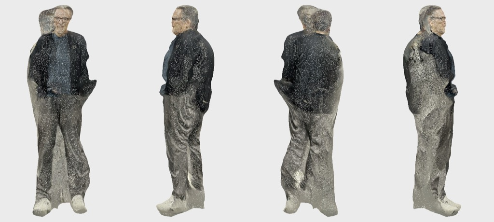
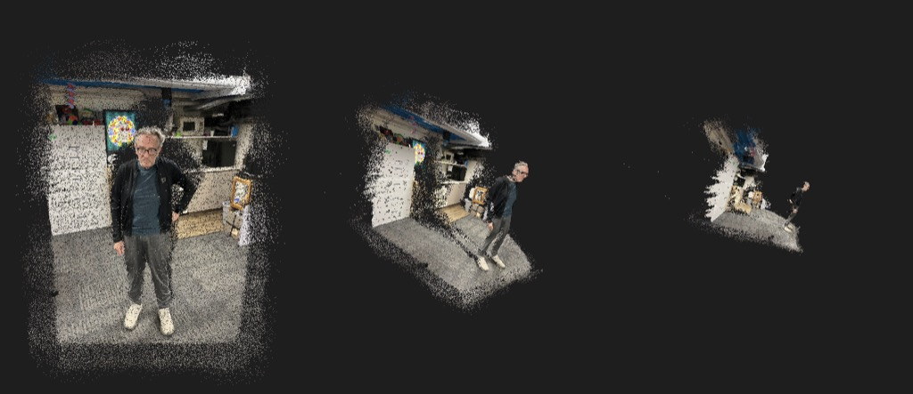

# TheTunnelAsset

3D assets for The Tunnel: Gaussian splats and meshes of David Goodsell, Art, and the Scripps lab,
made from single photos and from a short phone video.

```
splat/        3D Gaussian Splatting .ply files (SHARP, one photo each)
mesh/         textured / vertex-colored meshes (.glb, .usdz)
thumbs/       small JPG thumbnails, one per asset
assets.json   machine-readable index of every asset (query this from apps)
tools/        build_manifest.py: regenerates assets.json
```

## Assets

| id | kind | subject | file | size |
|---|---|---|---|---|
| `goodsell_portrait_splat` | splat | David Goodsell | [splat/goodsell_portrait.ply](splat/goodsell_portrait.ply) | 66 MB |
| `scripps_virus_panel_splat` | splat | Scripps lab | [splat/scripps_virus_panel_IMG_7748.ply](splat/scripps_virus_panel_IMG_7748.ply) | 66 MB |
| `scripps_virus_models_7756_splat` | splat | Scripps lab | [splat/scripps_virus_models_IMG_7756.ply](splat/scripps_virus_models_IMG_7756.ply) | 66 MB |
| `scripps_virus_models_7757_splat` | splat | Scripps lab | [splat/scripps_virus_models_IMG_7757.ply](splat/scripps_virus_models_IMG_7757.ply) | 66 MB |
| `art_photo_splat` | splat | Art | [splat/art_photo_IMG_9389.ply](splat/art_photo_IMG_9389.ply) | 66 MB |
| `goodsell_portrait_mesh` | mesh | David Goodsell | [mesh/goodsell_portrait_mesh.glb](mesh/goodsell_portrait_mesh.glb) | 8 MB |
| `goodsell_portrait_mesh_bright` | mesh | David Goodsell | [mesh/goodsell_portrait_mesh_bright.glb](mesh/goodsell_portrait_mesh_bright.glb) | 8 MB |
| `goodsell_portrait_splatlook` | mesh | David Goodsell | [mesh/goodsell_portrait_splatlook.glb](mesh/goodsell_portrait_splatlook.glb) | 56 MB |
| `art_photo_mesh` | mesh | Art | [mesh/art_photo_IMG_9389_mesh.glb](mesh/art_photo_IMG_9389_mesh.glb) | 23 MB |
| `art_video_fullbody_glb` | mesh | Art | [mesh/art_video_IMG_9390_fullbody.glb](mesh/art_video_IMG_9390_fullbody.glb) | 11 MB |
| `art_video_fullbody_usdz` | mesh | Art | [mesh/art_video_IMG_9390_fullbody.usdz](mesh/art_video_IMG_9390_fullbody.usdz) | 22 MB |

<p>


</p>

## How they were made

- **Splats**: [SHARP](https://github.com/apple/ml-sharp) (Apple), one photo in, one 3DGS `.ply` out
  (about 1.18M Gaussians, 2 layers of 768x768). SHARP reconstructs only what the camera saw, so
  the back of every scene is empty. Look at them from roughly the front.
- **2.5D meshes** (`goodsell_portrait_*`, `art_photo_mesh`): the front layer of a SHARP splat
  triangulated as a grid, with triangles across depth jumps removed. A relief, not a closed object.
- **Full-body mesh** (`art_video_fullbody_*`): Apple Object Capture (RealityKit
  `PhotogrammetrySession`, medium detail) on 134 sharp frames from a 17 s orbit video.
  It is a full 360 degree model, but the subject moved during the capture, so there is a faint ghost second head
  and an extra sheet of surface on one side. Its scale is arbitrary (about 1.35 m tall), so rescale it to his real
  height before use. It is a candidate for auto-rigging (Mixamo / AccuRIG, then Unity Humanoid).

## Coordinate conventions

| kind | convention | up | notes |
|---|---|---|---|
| splat `.ply` | OpenCV: x right, **y down**, z forward | -Y | camera at origin looking +Z; rotate 180 deg about X for y-up viewers (SuperSplat, Unity) |
| mesh `.glb` / `.usdz` | glTF: x right, **y up** | +Y | opens upright in Blender, Unity, three.js, Quick Look |

Splat `.ply` files use the standard 3DGS layout (`x y z f_dc_0..2 opacity scale_0..2 rot_0..3`,
degree-0 SH, sRGB colors), so they load in SuperSplat, gsplat.js, Spark, three.js splat loaders, and
[UnityGaussianSplatting](https://github.com/aras-p/UnityGaussianSplatting) (import step needed in Unity).

## Using `assets.json` from an app

Every asset has a direct, streamable URL:

```
https://raw.githubusercontent.com/autinlab/TheTunnelAsset/main/<path>
```

`assets.json` lists every asset with its `id`, `kind` (`splat` or `mesh`), `subject`, `tags`, `format`,
`mime`, `url`, `bytes`, `sha256` (for caching), `thumbnail`, `coordinates`, and per-format stats
(`gaussians` for splats; `vertices`, `faces` for GLB). Files under 20 MB also have a `cdn_url` on
jsDelivr, which is faster and has CORS caching.

```js
const BASE = "https://raw.githubusercontent.com/autinlab/TheTunnelAsset/main/";
const index = await (await fetch(BASE + "assets.json")).json();

// all splats of the Scripps lab
const splats = index.assets.filter(a => a.kind === "splat" && a.subject === "scripps");

// one asset by id, streamed
const art = index.assets.find(a => a.id === "art_video_fullbody_glb");
const res = await fetch(art.url);            // raw.githubusercontent.com sends CORS: *
const reader = res.body.getReader();         // stream it, or just: await res.arrayBuffer()
```

```csharp
// Unity
var req = UnityWebRequest.Get("https://raw.githubusercontent.com/autinlab/TheTunnelAsset/main/assets.json");
yield return req.SendWebRequest();
var json = req.downloadHandler.text;  // parse with JsonUtility / Newtonsoft, then GET asset.url
```

```bash
# command line: list the ids and URLs of all meshes
curl -s https://raw.githubusercontent.com/autinlab/TheTunnelAsset/main/assets.json \
  | jq -r '.assets[] | select(.kind=="mesh") | "\(.id)\t\(.url)"'
```

Things to know about `raw.githubusercontent.com`:
- It sends `Access-Control-Allow-Origin: *`, so browsers can fetch directly.
- It supports HTTP range requests, but it doesn't guarantee bandwidth and is rate-limited for heavy traffic. For
  production, mirror the files to a CDN or object storage and keep the same `path`s.
- GitHub rejects files over 100 MB. Keep new splats under that, or compress them first (`.spz` / `.sog`).

## Adding an asset

1. Put the file in `splat/` or `mesh/` and a JPG thumbnail in `thumbs/`.
2. Add an entry to `ASSETS` in `tools/build_manifest.py`.
3. Run `python tools/build_manifest.py` (needs `numpy plyfile trimesh`), then commit `assets.json`
   with the files.
